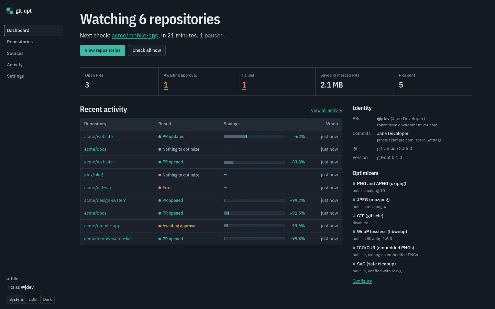
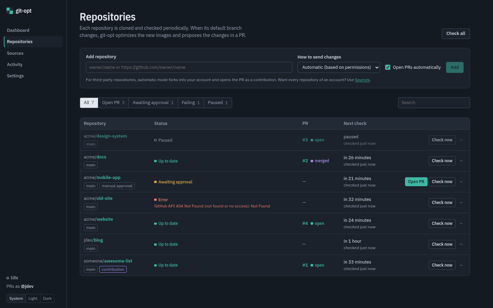
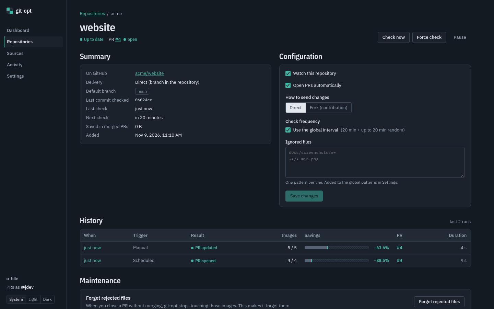
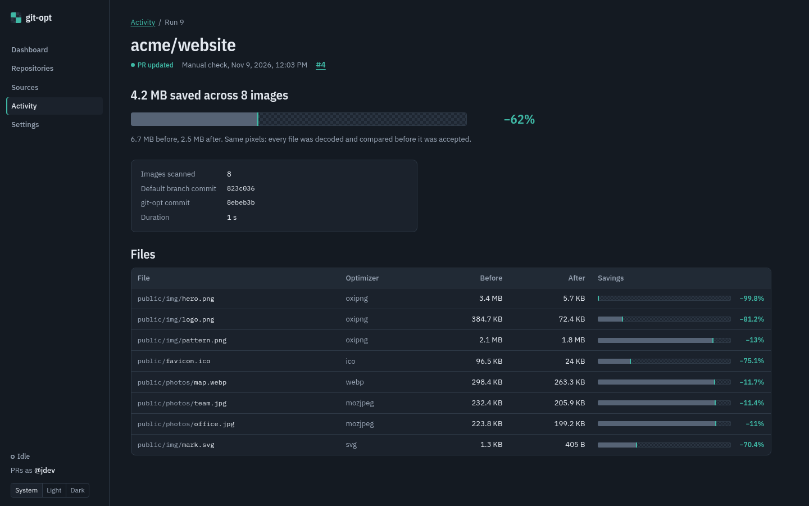
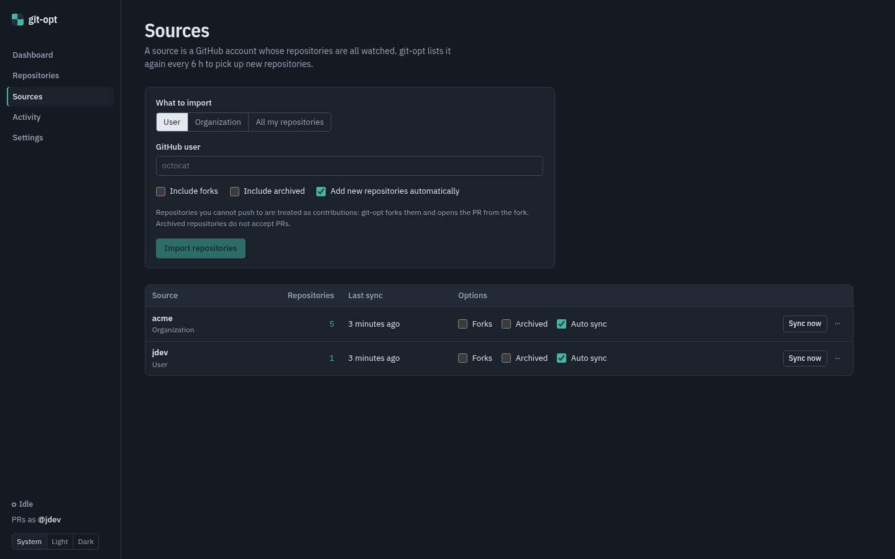
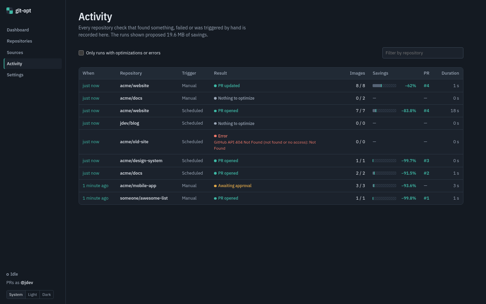
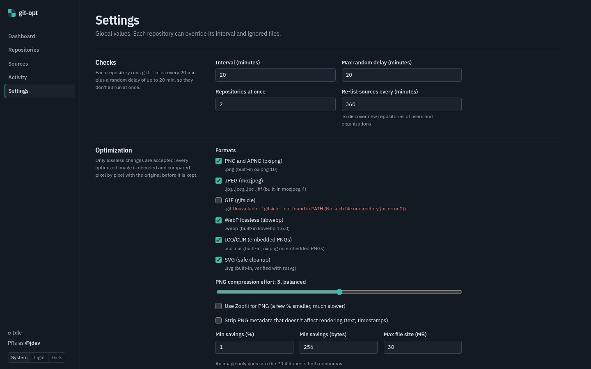

# git-opt

**A self-hosted bot that keeps the images in your GitHub repositories losslessly optimized, and opens the pull requests in your name.**

You point it at repositories (yours, your organization's, or third-party projects you want to contribute to). It keeps a clone of each one, notices when the default branch changes, recompresses every image that was never optimized, **proves** the result is pixel-identical, and opens or updates a PR. It is the ImgBot idea, running on your own machine, acting as you.



- **Lossless, verified.** PNG and APNG, JPEG, GIF, WebP, ICO/CUR, ICNS, SVG (including the images embedded in it) and SVGZ. Every result is proven equivalent before it is kept: decoded and compared pixel by pixel (and, for SVG, XML tree and rendering compared); anything that differs is thrown away.
- **Runs on its own.** Each repository is checked every 20 minutes plus a random delay of up to 20 minutes, in the background, a few at a time.
- **Remembers what it did, in git.** Its commits carry a marker, so it recognizes already-optimized images from the commit history, whether its PR was merged, rebased or squashed, and even after a reinstall.
- **Acts as you.** Commits use your `git config` identity; pushes and PRs use your GitHub token. No bot account, no GitHub App.
- **Contributes to other projects.** If you can't push to a repository, it forks it into your account and opens the PR from there. You can review every result before the PR goes out.
- **Scales to whole accounts.** Import all repositories of a user, an organization, or everything you can access, and new ones are picked up automatically.
- **One container.** Rust backend, Vue UI with light and dark themes, SQLite, system `git`: one Docker image, or one binary.

## How it works

```
 every 20 min + random(0–20 min), for each repository
 ┌──────────────────────────────────────────────────────────────────────────────┐
 │ 1. git fetch the default branch           nothing new? → done                │
 │ 2. list images; skip the ones that are                                       │
 │      · ignored by your patterns / in Git LFS / too big                       │
 │      · written by a previous git-opt commit (found via its marker in history)│
 │      · rejected by maintainers in a PR closed without merging                │
 │      · already known to be optimal (content-addressed cache)                 │
 │ 3. optimize each image → decode both versions → keep only if pixel-identical │
 │ 4. commit as you:  "[git-opt] Optimize images" + per-file sizes + marker     │
 │ 5. push branch git-opt/optimize-images (to the repo, or to your fork)        │
 │ 6. open the PR, or update the one already open (or wait for your approval)   │
 └──────────────────────────────────────────────────────────────────────────────┘
```

Every git-opt commit ends with the trailer `Git-Opt: lossless-optimization`. On each check git-opt asks git for the blobs those commits wrote; since a blob id is a hash of the file content, an optimized image is recognized no matter how the PR was merged, and an image edited afterwards is evaluated again. When a PR is closed without merging, its files are never proposed again for that repository.

A typical commit:

```
[git-opt] Optimize images

*Total -- 421.87 KiB -> 56.78 KiB (86.54%)

img/big.png -- 352.22 KiB -> 1.30 KiB (99.63%)
img/icon.png -- 8.35 KiB -> 742 B (91.32%)
img/photo.jpg -- 61.30 KiB -> 54.75 KiB (10.68%)

Git-Opt: lossless-optimization
```

The full walkthrough, including scheduling, caching, identity and the security model, is in [docs/how-it-works.md](docs/how-it-works.md).

### What "lossless" means here

| Format | Tool | What changes | What never changes | How it is proven |
|---|---|---|---|---|
| PNG, APNG | [oxipng](https://github.com/shssoichiro/oxipng) (built in), optional Zopfli | filters, deflate, lossless color-type/bit-depth/palette reduction; every animation frame | pixels (including the color of transparent pixels), frames, delays, loop count; metadata unless you opt in to stripping non-rendering chunks | decoded RGBA of the image and of every composited frame |
| JPEG | [mozjpeg](https://github.com/mozilla/mozjpeg) (built in), a lossless transcode like `jpegtran -copy all -optimize -progressive` | Huffman tables, progressive scan script (or baseline when smaller) | DCT coefficients; every APPn/COM segment: EXIF (orientation), ICC, XMP, comments | decoded pixels + metadata segments byte for byte |
| GIF | `gifsicle -O3` (never `--lossy`) | frame encoding | every composited frame and its delay | every composited frame and delay |
| WebP | libwebp (built in), `-lossless -z 9 -exact`, lossless files only | the lossless bitstream | pixels (including under transparency); ICC, EXIF, XMP and every other chunk | decoded pixels (independent decoder) + chunks byte for byte |
| ICO, CUR | oxipng on the embedded PNG images | PNG compression | pixel format of each image, BMP images, the icon directory | per-image pixels, IHDR and directory fields |
| ICNS | oxipng on the embedded PNG images | PNG compression; the `TOC ` sizes | pixel format of each image, every other element (RLE, masks, JPEG 2000, `info`…) | per-element pixels and IHDR, other elements byte for byte, TOC consistent |
| SVG | built-in cleanup | comments (license notices kept), editor metadata (Inkscape, Illustrator, Sketch, Figma…), whitespace between tags; embedded PNG/JPEG/WebP/GIF images (`data:` URIs) optimized by their own optimizer | paths, numbers, ids, classes, styles, every other attribute value, element order, text, DOCTYPE | XML tree (independent parser) + each embedded image by its own verifier + pixels rendered by resvg |
| SVGZ | the SVG cleanup above, then Zopfli | the SVG inside, the deflate stream | the gzip header (file name, time, flags) | gzip header byte for byte + the SVG proof on the decompressed content |

A result is kept only if it is proven equivalent **and** saves at least 1% and 256 bytes (configurable).

Deliberately never done: lossy re-encoding of any kind, converting between formats (it would rename files and break references), touching lossy or animated WebP, damaged JPEGs, AVIF/HEIC/JPEG XL, BMP or TIFF.

## Screenshots

| | |
|:-:|:-:|
|  **Repositories**: every state at a glance; open a waiting PR with one click |  **Repository**: per-repo mode, interval, ignored files, history |
|  **Run**: what changed in each file |  **Sources**: import whole users or organizations |
|  **Activity**: everything the bot did |  **Settings**: intervals, formats, thresholds, identity, token |

Light, dark or system theme, switchable from the sidebar.

## Quick start

With Docker (bundles git and gifsicle; every other optimizer is built in):

```bash
git clone https://github.com/otsobide/git-opt.git && cd git-opt
export GITHUB_TOKEN=$(gh auth token)
export GIT_OPT_ADMIN_TOKEN=$(openssl rand -hex 24)   # the UI will ask for it
docker compose up -d --build                          # → http://localhost:8484
```

From source (Rust ≥ 1.88 with a C compiler, Node ≥ 20, git; plus `gifsicle` for GIF):

```bash
(cd frontend && npm ci && npm run build)
cargo build --release
./target/release/git-opt                              # → http://127.0.0.1:8484
```

Then add a repository with **Open PRs automatically** unticked, look at the result, and press **Open PR**. [docs/getting-started.md](docs/getting-started.md) walks through it, including running it as a systemd user service.

The token is taken from the UI's Settings, then `GITHUB_TOKEN`/`GH_TOKEN`, then `gh auth token`. It never appears on a command line or in a URL.

## Documentation

| | |
|---|---|
| [Getting started](docs/getting-started.md) | install and open your first PR |
| [Using git-opt](docs/usage.md) | every screen, plus recipes (contribute to a project, ignore files, review before PRs…) |
| [How it works](docs/how-it-works.md) | the full pipeline and its guarantees |
| [Configuration](docs/configuration.md) | environment variables, settings, tokens, ignore patterns |
| [Troubleshooting](docs/troubleshooting.md) | common errors and fixes |
| [HTTP API](docs/api.md) | automate it |
| [Architecture](docs/architecture.md) | code layout, job queue, data model |
| [Development](docs/development.md) | build, test, demo, screenshots, adding optimizers |

## Development

```bash
cargo test && cargo clippy --all-targets   # backend
(cd frontend && npm run build)             # type-check + build the UI
scripts/e2e.sh                             # full flow against a fake GitHub, never touches github.com
scripts/demo.sh                            # explore the UI with sample repositories
```

Adding a format means implementing one trait (`Optimizer`) whose `verify` proves equivalence; see [docs/development.md](docs/development.md#adding-a-new-optimizer). Contributor and agent conventions are in [AGENTS.md](AGENTS.md).
