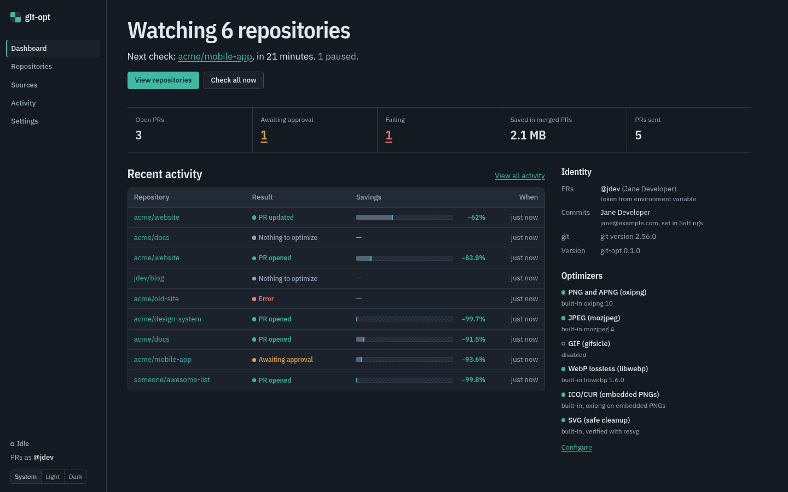
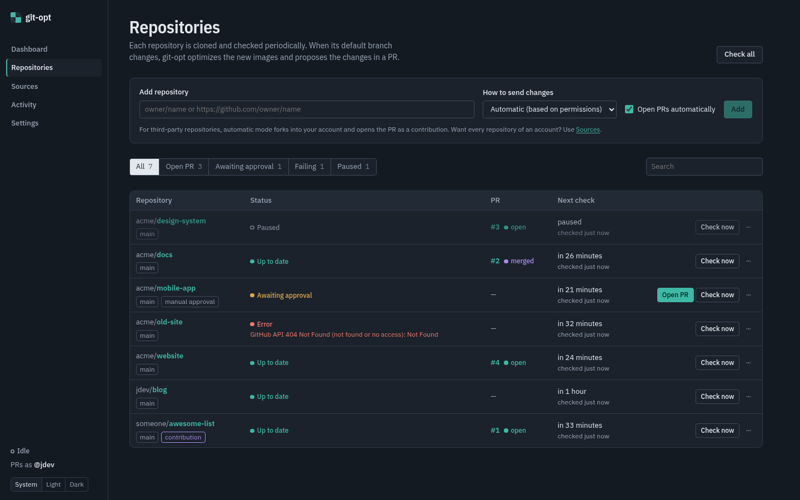
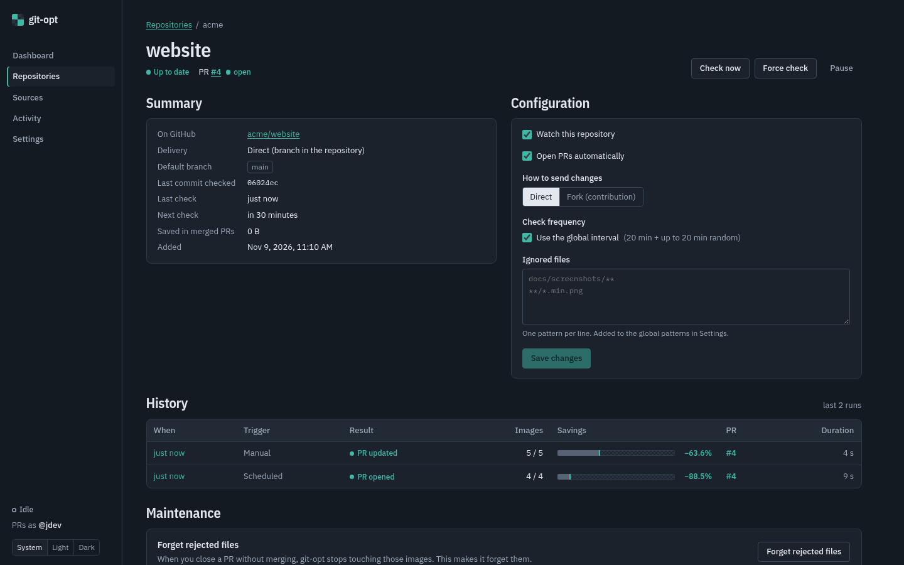
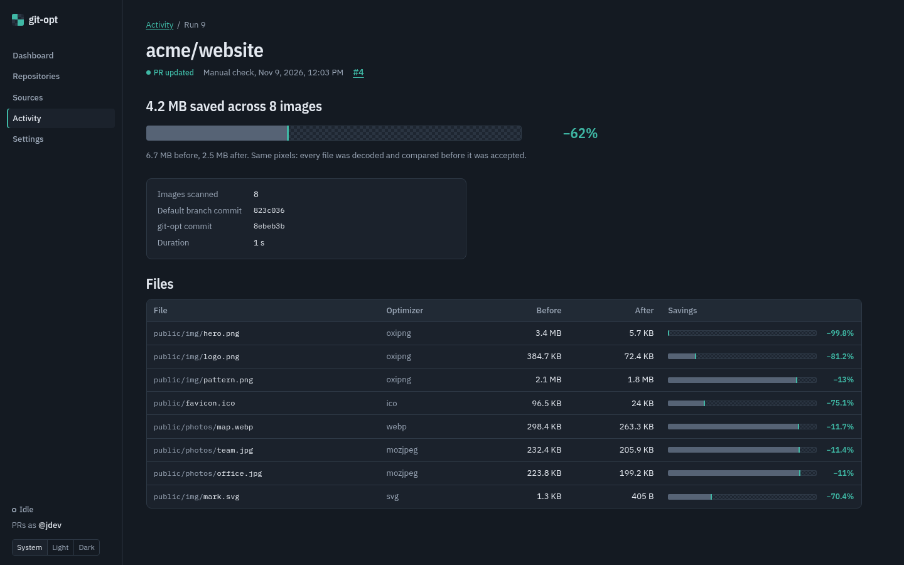
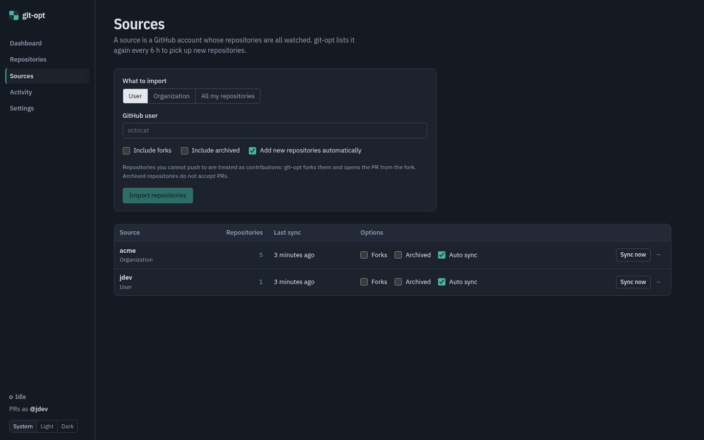
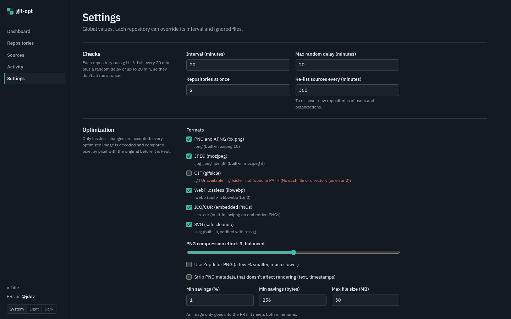

# Using git-opt

A tour of every screen, followed by recipes for common tasks. If you have not installed git-opt yet, start with [getting-started.md](getting-started.md).

The sidebar is always visible. At the bottom it shows whether jobs are running or queued, which GitHub account PRs are sent as, and a **System / Light / Dark** theme switcher (*System* follows your OS; the choice is remembered in the browser).

## Dashboard

- **Headline**: how many repositories are watched, which one is checked next and how many are paused. **Check all now** queues every enabled repository.
- **Banners**: problems that stop the bot from working, such as no usable GitHub token or a format whose tool is not installed.
- **Counters**: open PRs, repositories *awaiting approval*, *failing* repositories (click through to the filtered list), bytes saved in merged PRs and the total number of PRs sent.
- **Recent activity**: the latest runs with their result and savings. The bar shows the remaining size, and the checkerboard shows the bytes removed.
- **Identity**: the GitHub account behind the token (and where the token came from) and the commit author (and where it came from: Settings, git config or GitHub). Check this panel first after installing.
- **Optimizers**: each format, whether it is available here and the tool version.

## Repositories

**Add repository** accepts `owner/name`, `https://github.com/owner/name` or `git@github.com:owner/name.git`.

- **How to send changes**:
  - *Automatic (based on permissions)*: direct if you can push, fork otherwise (recommended);
  - *Direct*: push the bot branch to the repository itself;
  - *Fork (contribution)*: push to your fork and open a cross-repository PR.
- **Open PRs automatically**: when unticked, the bot prepares the commit and waits for you to press **Open PR**.

The list can be filtered (*All*, *Open PR*, *Awaiting approval*, *Failing*, *Paused*) and searched. Each row shows:

- the repository with tags for its default branch, `contribution` (fork mode) and `manual approval`;
- its **status**: *Pending* (never checked), *Up to date*, *Awaiting approval*, *Error* (with the message), *Paused*, or what it is doing right now (*Cloning*, *Optimizing 3/12: img/logo.png*…);
- the latest bot **PR** and its state (*open*, *merged*, *closed*);
- when it will be checked next and when it was last checked.

Row actions: **Open PR** (when awaiting approval), **Check now**, and in the `⋯` menu **Force check** (re-scan even if nothing changed), **Pause** / **Resume** and **Remove from list**. **Check all** queues every enabled repository.

## Repository page

- **Summary**: link to GitHub (and to your fork in fork mode), delivery mode, default branch, last commit checked, last and next check, and bytes saved in merged PRs.
- **Configuration**:
  - **Watch this repository**: untick to pause scheduled checks;
  - **Open PRs automatically**;
  - **How to send changes**: *Direct* or *Fork (contribution)*;
  - **Check frequency**: keep *Use the global interval* or set a custom interval in minutes (the global random delay still applies);
  - **Ignored files**: patterns for this repository only, added to the global ones (see [syntax](configuration.md#ignore-patterns)).

  Press **Save changes**.
- **History**: every recorded run with its trigger (*Scheduled*, *Manual*, *Publish*), result, images optimized/scanned, savings, PR and duration. Click a run for details.
- **Maintenance**:
  - **Forget rejected files**: files from PRs that were closed without merging are never proposed again; this clears that list.
  - **Remove repository**: deletes the local clone and the run history. It never touches GitHub: open PRs stay open.

## Activity and run details

**Activity** lists runs across all repositories. Routine scheduled checks that found nothing new are not recorded, so this list only shows runs that changed something, failed or were started by hand.

A run page shows the result, the total saving, the commits involved (default branch HEAD and the bot's commit) and a table with every file: path, optimizer, size before and after, and saving. Failed runs show the error message.

## Sources

A source imports every repository of a GitHub account:

- **User**: a user's own repositories (when it is you, private ones are included);
- **Organization**: every repository of an organization;
- **All my repositories**: everything the token can access (your own, collaborations and organizations you belong to).

**Include forks** and **Include archived** are off by default (archived repositories cannot receive PRs). **Add new repositories automatically** (*Auto sync* in the list) re-lists the account periodically (every 6 hours by default) to pick up new repositories. Imported repositories use direct mode when you can push and fork mode otherwise.

In the list, **Sync now** re-lists immediately. The `⋯` menu removes the source, either keeping its repositories or removing them too.

## Settings

Global settings, grouped in **Checks**, **Optimization**, **Ignored files**, **Commits and PRs** and **GitHub**. Every field is described in [configuration.md](configuration.md#global-settings). Highlights:

- **Formats**: enable or disable each optimizer; unavailable tools are flagged.
- **PNG compression effort**: from *fast* to *maximum savings, very slow*.
- **Commit author** / **Author email**: leave empty to use your git config.
- **Sign commits**: untick if the server cannot reach your signing key.
- **GitHub**: save a token (it is validated and never shown again) or **Remove saved token** to fall back to environment variables or `gh`.

## Recipes

### Optimize my own repositories, hands-off
**Sources → All my repositories** (or *User* with your login) → **Import repositories**. Leave **Open PRs automatically** on. New repositories you create are picked up at the next re-sync.

### Contribute to an open-source project
**Repositories → Add**: `owner/project`, *Automatic* mode (it becomes *Fork*), and untick **Open PRs automatically** so you can review the result first. When it shows **Awaiting approval**, read the run, then press **Open PR**. The PR comes from `you:git-opt/optimize-images` with *allow edits by maintainers* enabled. If the maintainers close it without merging, git-opt will not propose those files again.

### Keep some files untouched
Add patterns to **Ignored files**, globally in Settings or per repository: `docs/screenshots/`, `*.min.png`, `assets/raw/**`. The next check skips them. Already open PRs are rebuilt without them at the next check if the default branch moves; press **Force check** to rebuild now.

### Pause a repository
**Pause** in the row menu or untick **Watch this repository**. Manual checks still work. **Resume** checks immediately.

### Re-evaluate everything after changing the PNG effort
Raising **PNG compression effort** changes the PNG optimizer's profile, so PNGs previously found optimal are evaluated again on the next check that scans the repository. Use **Force check** (or **Check all** after a force) to do it now.

### A maintainer closed my PR but now wants it
Open the repository, press **Forget rejected files**, then **Force check**. The bot proposes those files again.

### Review before every PR
Untick **Open PRs automatically** on the repository. Each time the default branch changes and there is something to optimize, the repository goes to **Awaiting approval** until you press **Open PR**.

## Try it without GitHub

`scripts/demo.sh` starts git-opt against a fake GitHub API with sample repositories in every state (the screenshots on this page come from it). See [development.md](development.md#demo-and-screenshots).
